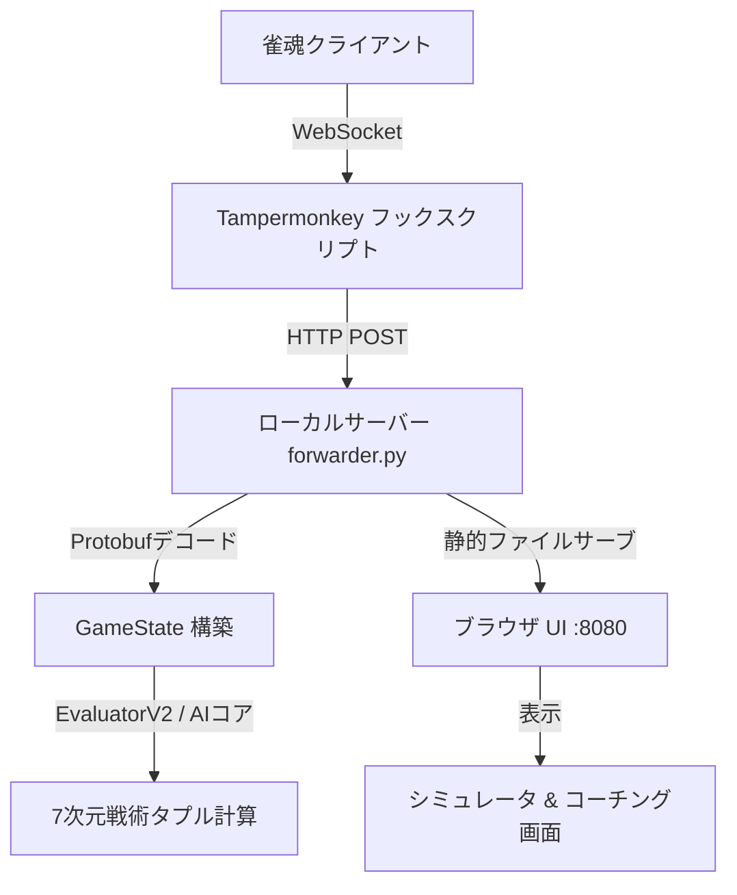

# 雀魂コーチングくん (MJsoulCoaching)

雀魂 (Mahjong Soul) の対局データをリアルタイムにキャプチャし、ブラウザ上でAIによる「打牌・ベタオリ判断のコーチング（何切る相談）」を提供する、非公式の研究・開発者向けツールです。

> [!WARNING]
> **免責事項 (Disclaimer)**
> 本ツールは個人による研究および学習目的で作成された非公式のオープンソースソフトウェアです。
> 雀魂の利用規約（外部ツールの使用禁止、リバースエンジニアリング・パケット解析の禁止等）に抵触する可能性があるため、本ツールの使用によって生じたゲームアカウントの停止（BAN）、その他いかなる不利益や損害についても、開発者は一切の責任を負いません。
> 本ソフトウェアの導入および使用は、すべてユーザー自身の自己責任において行ってください。
> チート行為はありませんが、BANされる危険性は排除できないので、牌譜のDLはサブ垢を使うことを推奨します。

---

## 🚀 主な機能

### エンドユーザー・プレイヤー向け
- **リアルタイム牌譜キャプチャ**: 
  ブラウザ拡張機能 `Tampermonkey` を使用し、雀魂の牌譜を自動的にローカルサーバーへ転送して保存・記録します（プロキシ設定や難しいネットワーク解析設定は不要です）。
- **ビジュアル牌譜シミュレータ**: 
  保存した牌譜データを、1打ずつ巻き戻し・早送りしながらブラウザ上で視覚的に再生できます。
- **AIリアルタイムコーチング UI**: 
  任意の局面において、AIが「何を切るべきか」「今押すべきかオリるべきか（押し引き）」を7次元の評価タプルと日本語の戦術的根拠（理由説明）付きで解説します。
- **何切る相談プロンプト**: 
  盤面データをGPTなどのLLMへ一発で相談できる形式でクリップボードにコピー可能です。
- **超簡易な使い方説明**:
  ブラウザに Tampermonkey 拡張機能をインストール ➡ Pythonをインストール ➡ python server/forwarder.py でサーバーを起動 ➡ サーバーのページ右上の Tampermonkey スクリプトを導入 ➡ 雀魂を起動 ➡ DLしたい牌譜を開くとローカルに保存される ➡ 評価が終わるまで待ってから、見たい牌譜をクリックして開く

### 開発者・研究者向け
- **同梱AIモデルとの対局テスト**: 
  `akochan` などの強豪AIとMJAIプロトコルを介してローカル対局テストを実行可能。
- **戦術LLMの自力学習**: 
  天鳳の公開ログデータを用いて、プレイヤーの打牌傾向に応じた戦術判断モデルをスクラッチで学習可能。

---

## 🤖 同梱されている麻雀AIモデルについて

本プロジェクトには、設計思想の異なる **2つのAIモデル** が同梱されており、設定によって切り替えが可能です。

### 1. ver.1 (旧AI)
*   **特徴**: 天鳳の一般対局データに基づき、人間の打牌一致率（特に標準的な門前牌効率や平均的な押し引き）を再現することを優先した、初期のルールベース＋ファジィ推論ベースのAIモデル。

### 2. ver.2 (新AI - 推奨)
*   **特徴**: 現代麻雀の勝率を最大化するために徹底的にチューニングされた強力なハイブリッドAI。
    *   **他家放銃警戒度 (opponent model)**: 他家の仕掛け（3副露、2副露＋ドラ）やリーチ状況から危険度をリアルタイム数値化。
    *   **クランプ回し打ち (DEFEND)**: 安全な牌（スジ・現物）がある時のみシャンテン戻しをして迂回し、危険牌しかない場合は押す、メリハリのある守備ロジック。
    *   **役満（国士無双）粘り制御**: 他家に危険な気配があっても、安全な不要牌（中張牌や、手牌に重複している余剰麼九牌）がある限りは国士の手牌維持を粘り、安全な不要牌が尽きた時点で麼九牌を崩してベタオリ（FOLD）する高度な戦術。
    *   **戦術決定LLM**: 深層学習モデル `TacticalTransformer` が、同卓者のスタッツ（打牌傾向）と手牌と場況に応じて最適な戦術モードを動的に選択。

---

## 🛠️ 動作原理 (System Architecture)



1. **キャプチャ**: 雀魂起動時に `majsoul_hook.js` が WebSocket 送受信データを横取りします。
2. **転送**: キャプチャした Protobuf データをローカルの `forwarder.py` (Port: 8080) に送信。
3. **パース**: `majsoul_wrapper` に内包された `liqi.py` と Protobuf 解析定義を用いて JSON 形式にデコード・変換し、牌譜ログとして保存します。
4. **評価**: 盤面を再現したシミュレータ画面からAPI経由で `EvaluatorV2` を呼び出し、各打牌の評価タプルと日本語の解説をリアルタイムで出力します。

---

## 💻 クイックスタート (開発環境セットアップ)

### 1. 依存関係のインストール
動作には Python 3.10 以上が必要です。

```bash
# 必要なライブラリをインストール
pip install -r requirements.txt
```

### 2. ローカルサーバーの起動
```bash
python server/forwarder.py
```
起動すると、`http://localhost:8080/` で Web サーバーが立ち上がります。

### 3. フックスクリプトのブラウザ導入
1. ブラウザで `http://localhost:8080/` にアクセスします。
2. 画面上の **「🔧 Tampermonkey スクリプトを導入」** ボタンをクリックし、拡張機能にスクリプトをインストールします。
3. 雀魂にログインして、牌譜や対局を開始します。自動的に `server/data/` 以下にキャプチャされた牌譜データが保存されます。
4. 対局終了後、`http://localhost:8080/` を開くと、保存された牌譜一覧からシミュレータを再生できます。

---

## 🤖 開発者向け機能の使い方

### 1. AI と Akochan のローカル対局シミュレーション
AIの強さや勝率統計を測定するため、ローカルの `akochan` と対局を実行します。

> [!IMPORTANT]
> このシミュレーションを実行するには、事前にローカルの Docker 環境で **`mjai-server` (対局管理サーバー)** および **`akochan-docker-app` (対戦相手の Akochan 本体)** のコンテナをビルド・起動しておく必要があります。

```bash
# 準備が完了した状態で対局シミュレーションを開始
python tools/mjai_battle.py
```

---

### 2. 戦術LLM (TacticalTransformer) の学習手順
プレイヤーのスタッツに応じた最適な戦術モード予測を行う深層学習モデルを、天鳳のログデータから再学習させる手順です。

#### 📥 データセットのダウンロードと配置
1. 天鳳の公開ログアーカイブ（`mjlog` 形式）から、XML形式の牌譜データをダウンロードします。
2. ダウンロードしたファイルを、プロジェクト内の `data/raw/tenhou_xml/` ディレクトリ配下に配置します。

#### 🏋️ 学習パイプラインの実行
```bash
# ① プレイヤーごとのスタッツDB (stats_db.json) の構築
python tools/build_stats_db.py

# ② 天鳳ログのトークナイズ前処理 (tokenized_data.json の生成)
python tools/tokenize_tactical_data.py

# ③ PyTorch による TacticalTransformer の学習
python tools/train_tactical_llm.py
```
学習が正常に完了すると、`models/` ディレクトリ以下に重み（ウェイトファイル）が出力され、`strategy_v2.py` による推論時に自動でロードされるようになります。

---

## 📂 リポジトリ構成

```
MJsoulCoaching/
├── README.md                    # 本ファイル
├── LICENSE                      # MIT License
├── requirements.txt             # 依存モジュールリスト
│
├── core/                        # 麻雀 AI コア (ver.2)
│   ├── ai_player.py             # メインエントリ
│   ├── evaluator_v2.py          # 7D評価器 & モード遷移
│   ├── strategy_v2.py           # 戦術決定 (TacticalTransformer)
│   ├── defense_v2.py            # 安全度計算 & 他家警戒度判定
│   ├── yakuman_v2.py            # 役満(国士無双含む)専用タプル & 粘り制御
│   └── game_state.py            # ゲーム状態管理
│
├── server/                      # コーチング Web サーバー
│   ├── forwarder.py             # HTTP API & 静的ファイルサーブ
│   ├── templates/
│   │     └── simulator_v2.html  # シミュレータ HTML
│   └── static/                  # リファクタリング済み静的リソース
│         ├── css/
│         │    └── simulator_v2.css  # UIスタイル
│         └── js/
│              ├── simulator_v2_utils.js  # 描画・変換関数群
│              └── simulator_v2_main.js   # 再生コアロジック & API通信
│
├── majsoul_wrapper/             # 雀魂 Protobuf パケット解析コア
├── tools/                       # シミュレーション・天鳳データ前処理・モデル学習スクリプト群
└── config/                      # 戦術パラメータ (GA調整対象)
```

---

## ⚖️ ライセンス & クレジット

本プロジェクトは **MIT License** で公開されています。詳細は [`LICENSE`](LICENSE) を参照してください。

### サードパーティライブラリ
- **`majsoul_wrapper/`**: Copyright (c) 2020 Yue Qin, MIT License
  - 雀魂 WebSocket パケットのバイナリデコードに活用しています。
- **`core/manue/`**: Copyright (c) 2014 tubuann, MIT License
  - 対戦比較の検証用麻雀AIとして同梱しています。

### 謝辞
本ツールの開発にあたり、多くの先駆的な麻雀AI研究・ライブラリを参考にさせていただきました。
- [Akochan](https://github.com/Akagi201/akochan) - コーチングAIのチューニングのための対戦相手
- [mjai-gateway](https://github.com/tomohxx/mjai-gateway) - AI同士の対戦環境用
- [Cryolite](https://github.com/smly/Cryolite) - 天鳳ログ（XML形式のmjlog）を解析・パースして、学習用データセットを生成するための基礎ライブラリとしての参考
- [mahjong-soul-wrapper](https://github.com/mjsoul/mahjong-soul-wrapper) - 雀魂のプロトコル解析およびパケット傍受ロジックのベース
- [雀魂牌譜屋 (Amae-Koromo / Koromo Portal)](https://amae-koromo.sapk.ch/) - プレイヤー統計（スタッツ）項目およびデータ構造設計の参考
- [manue](https://github.com/tubuann/manue) - 対戦比較・検証用として活用させていただいたオープンソース麻雀AI