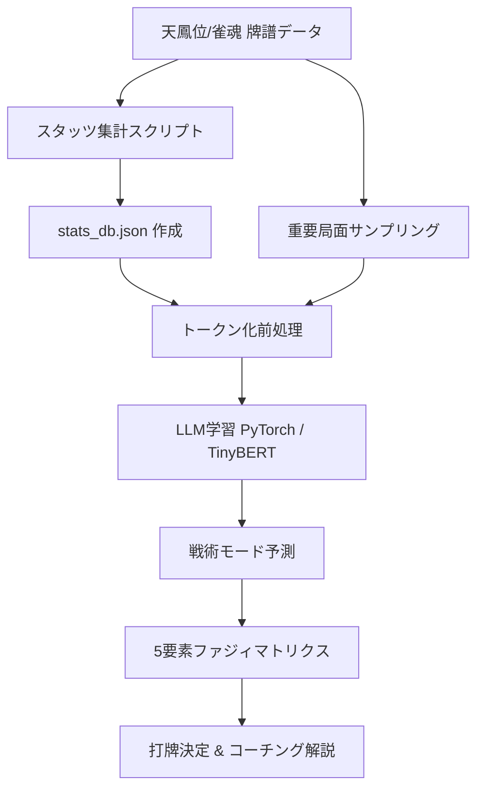

# 空切り（手出し・ツモ切り）の導入とオリジナルLLM（戦術モード）の設計計画（牌譜屋スタッツ完全復元版）

## Goal

本計画では、akochan 等の強豪AIに対抗すべく、麻雀AI Ver.2 を根本的に改良するための第一歩として、および対局シミュレータの分析能力を雀魂牌譜屋（甘衣ころも）のスタッツ仕様に完全準拠させるために、以下の3点に対応します。

1. **雀魂牌譜屋のスタッツ仕様に合わせた詳細スタッツ出力の復元（デグレ修正）**:
   対局テストスクリプト `v1_vs_v2_battle.py` において、かつて出力されていた雀魂牌譜屋の主要なスタッツ指標（和了率、放銃率、副露率、立直率、ダマテン率、平均打点、平均銃点、和了巡数、ツモ率、飛び率など）を牌譜屋の定義と完全に一致させて出力するように修復します。
2. **空切り（ツモ切りと手出しの選択）の導入**:
   同じ牌を引いた際に「ツモ切り」と「手出し」を状況に応じて使い分ける（空切り）ことで、他家への情報制限やテンパイ気味のプレッシャー（ブラフ）を可能にする小さいルールを実装します。
3. **オリジナルLLM（戦術モード選択）の設計と開発ロードマップ**:
   ユーザーが提案した「プレイヤーのスタッツ（ペルソナ）を前提条件として入力に渡し、戦術モードを決定する」麻雀特化型 Small Language Model (SLM) の具体的な設計と、データ収集・前処理・学習・統合の手順についてロードマップを提示し、壁打ちを行います。

---

## User Review Required

> [!IMPORTANT]
> **牌譜屋スタッツ定義の整合性について**
> 牌譜屋の「默听率（ダマテン率）」は `ダマ和了 / 門前和了` (門前での和了に占めるダマテン和了の割合) で定義されます。また「平均銃点」の算出のために `PlayerGameStats` に `total_dealt_points` フィールドを新設して放銃時の失点を記録します。これらの定義で実装を進めてよろしいでしょうか。
> 
> **空切り判定の確率とトリガー条件について**
> 今回のプロトタイプでは、手牌が進行している局面（テンパイまたは一シャンテン）で、かつ攻撃またはバランスモードの時に **確率40%** で空切り（手出し）を行う仕様としています。この確率やトリガーとなるシャンテン数について調整の要望があればご提示ください。

---

## Proposed Changes

### 1. 雀魂牌譜屋仕様の詳細スタッツ出力の復元

#### [MODIFY] [mahjong_simulator.py](file:///c:/Users/Daikichi/Documents/code-workspace/MJsoulCoaching/tools/mahjong_simulator.py)
- `PlayerGameStats` クラスに、放銃時の失点合計を記録する `total_dealt_points: int = 0` を新設します。
- `MahjongSimulator` の和了・放銃処理（ロン発生時）において、放銃者（`dealt_in_seat`）の `total_dealt_points` に和了点数を加算する処理を追加します。

#### [MODIFY] [v1_vs_v2_battle.py](file:///c:/Users/Daikichi/Documents/code-workspace/MJsoulCoaching/tools/v1_vs_v2_battle.py)
- `run_one_game` の戻り値として、`v2_stats` (PlayerGameStats オブジェクト) そのものを呼び出し元に返します。
- `main` 関数内に、雀魂牌譜屋（甘衣ころも）の定義に準拠したスタッツ算出ロジックを実装します。
- サマリ出力の下に `=== 牌譜屋仕様スタッツ (ver.2) ===` セクションを新設し、詳細な5大指標＋拡張指標を出力します。

##### 牌譜屋仕様スタッツの算出定義:
- **和牌率 (和了率)**: `wins / total_kyoku * 100`
- **放铳率 (放銃率)**: `dealt_in / total_kyoku * 100`
- **副露率 (副露率)**: `kyoku_with_meld / total_kyoku * 100`
- **立直率 (立直率)**: `reach_declarations / total_kyoku * 100`
- **默听率 (ダマテン率)**: `damaten_wins / (wins - open_wins) * 100` (※門前和了におけるダマ和了割合)
- **自摸率 (ツモ率)**: `tsumo_wins / wins * 100`
- **平均打点**: `total_win_points / wins`
- **平均铳点 (平均放銃点)**: `total_dealt_points / dealt_in`
- **和了巡数**: `avg_win_turn`
- **飛び率**: `busted_count / games * 100`

---

### 2. 空切り（ツモ切りと手出し）のルール実装

#### [MODIFY] [mjai_client_v2.py](file:///c:/Users/Daikichi/Documents/code-workspace/MJsoulCoaching/tools/mjai_client_v2.py)
- `OurMjaiClientV2` に空切りを決定するメソッド `_should_karagiri` を追加します。
- `tsumo` ハンドラおよび `reach` ハンドラの通常打牌送信時において、切る予定の牌がツモ牌と同じであり、かつ手牌にもその牌が存在する（2枚以上所持）場合、`_should_karagiri` が True を返せば `tsumogiri = False` （手出し）として MJAI サーバーに送信します。
- コーチング表示にも空切り（手出し）を行った事実を出力するようにします。

---

### 3. 戦術モード決定オリジナルLLM of 設計・ロードマップ

#### ① 前処理: 自作スタッツデータベースの作成
- **抽出するスタッツ例（牌譜屋仕様スタッツの主要5大指標と完全に合わせます）**:
  - `win_rate` (和牌率)
  - `deal_in_rate` (放铳率)
  - `call_rate` (副露率)
  - `riichi_rate` (立直率)
  - `damaten_rate` (默听率)
  - `average_win_points` (平均打点)
  - `average_dealt_points` (平均銃点)

#### ② トークン設計とサンプリング（データ軽量化）
- **入力トークンの形式例**:
  `[Persona: 守備型] [Stats: win0.22 deal0.12 call0.33 riichi0.20 damaten0.15] [E1-0] [Scores: 28k-25k-22k-25k] [Shanten: 1] [Opp: Reach] -> [手牌...]`

---

## Verification Plan

### Automated Tests
- `python tools/v1_vs_v2_battle.py --v2-seats 0,1 --seeds 2` を実行し、結果サマリの下に `=== 牌譜屋仕様スタッツ (ver.2) ===` が正しく表示されることを検証します。
- `python tools/run_all_tests.py` を実行し、空切りルール追加後も34個の局面テストすべてが合格することを確認します。
- `python tools/mjai_battle_v2.py 1 1` を実行し、空切り（tsumogiri=False）が実際にMJAI通信で送信され、ゲームサーバーとのやり取りが正常に終了することを確認します。
